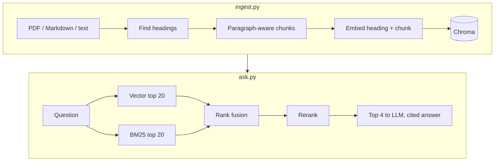

# pdf-chat

[](https://github.com/naman-sriv/pdf-chat/actions/workflows/tests.yml)

**Local RAG over PDFs with hybrid search, reranking and page-level citations.** On a 48-page NIST framework, the full pipeline gets the right passage into the LLM's context for **84%** of questions, versus **78%** for vector search alone. It ranks the right passage first for **62%**, and finds **8/8** exact-term lookups such as `GOVERN 6.1`, where vector search finds 4. Everything runs on your machine: no API keys, and no documents leave it.

```text
Question: What does GOVERN 1.7 require?
[1]

GOVERN 1.7: Processes and procedures are in place for decommissioning and
phasing out AI systems safely and in a manner that does not increase risks
or decrease the organization’s trustworthiness.

Sources:
  [1] nist-ai-rmf-1.0.pdf, p. 28, AI RMF Core > Govern
  [2] nist-ai-rmf-1.0.pdf, p. 27, AI RMF Core > Govern
  [3] nist-ai-rmf-1.0.pdf, p. 27, AI RMF Core > Govern
  [4] nist-ai-rmf-1.0.pdf, p. 46, Appendix C: AI Risk Management and Human-AI Interaction
```

*Real output from `llama3.1` on the [NIST AI RMF](samples/nist-ai-rmf-1.0.pdf), unedited.*

## How it works



- **Chunking:** each document is cut into sections at its headings (PDF bookmarks, or `#` headings in Markdown), then split on paragraphs, lines and sentences into chunks of up to 800 characters. Bookmark page numbers are often wrong, so each heading is located in the text itself: searching forward from the previous one, at the start of a line, ignoring case and section numbers, and skipping table-of-contents pages.
- **Metadata:** every chunk stores its source file, page number (PDFs) and section path, such as `AI RMF Core > Govern`. Answers cite these. Chunks that are only a heading (`1.2.2Risk Tolerance`, `4 EXPERIMENTS`) are dropped.
- **Embeddings:** `nomic-embed-text` requires task prefixes, so stored chunks are embedded as `search_document: …` and questions as `search_query: …`. Adding them raised vector-only Hit@1 from 53% to 59%.
- **Retrieval:** vector search and BM25 keyword search each return 20 candidates, which are merged with reciprocal rank fusion. Fusion uses rank positions, not scores, because the two searches score on different scales. The `BAAI/bge-reranker-base` cross-encoder reorders the merged list, and the top 4 go to the LLM.

## Evaluation

[`eval/evaluate.py`](eval/evaluate.py) compares the four retrieval stages on 32 labeled questions about the [NIST AI Risk Management Framework](https://nvlpubs.nist.gov/nistpubs/ai/NIST.AI.100-1.pdf) (48 pages, 241 chunks; a public-domain US government work). Each question is labeled with the section holding the answer and a phrase that must appear in the retrieved chunk. 24 questions are worded differently from the document (**concept**); 8 use exact terms such as `GOVERN 6.1` (**exact-term**).

| Method | Hit@1 | Hit@4 | MRR@10 | concept (hit@4) | exact-term (hit@4) | Latency / query |
| --- | --- | --- | --- | --- | --- | --- |
| BM25 only | 44% | 62% | 0.54 | 12/24 | **8/8** | <1 ms |
| Vector only | 59% | 78% | 0.68 | **21/24** | 4/8 | 11 ms |
| Hybrid (RRF) | 50% | **84%** | 0.66 | 20/24 | 7/8 | 19 ms |
| Hybrid + reranker | **62%** | **84%** | **0.73** | 19/24 | **8/8** | 310 ms |

Hit@4 is the share of questions whose answer reaches the LLM. What the numbers show:

- **The two searches fail on different questions.** Vector search misses half the exact-term questions, such as section IDs, while BM25 misses half the reworded ones. Hybrid search keeps most of both and reaches 84% Hit@4.
- **The reranker's gain is in ranking, not recall.** It doesn't get more answers into the top 4, but puts the right one first more often (Hit@1 62% vs 50% for hybrid), at about a third of a second per query on a laptop.
- **Vector search alone is best on reworded questions (21/24).** Fusion with BM25 costs one of those, and reranking another.
- **Two smaller fixes each moved the numbers.** Dropping heading-only chunks gained BM25 one question. Adding the embedding prefixes gained vector search two at Hit@1 and one at Hit@4, and hybrid search two at Hit@4.

Full per-question misses are in [`eval/results.md`](eval/results.md).

```bash
python eval/evaluate.py              # re-index samples/ and evaluate
python eval/evaluate.py --skip-index # reuse the index
```

## Limitations

- **Only retrieval is evaluated, not answers.** Answers also vary between runs. Asked "How should an organization decide how much AI risk is acceptable?", with the Risk Tolerance section retrieved both times, `llama3.1` once replied that the context gives no direct answer, and in a later run answered correctly with a citation.
- **The evaluation is small.** 32 questions on one document, so a one-question difference (3 points) is noise. The questions were written after reading the document, not by independent annotators.
- **Section names need PDF bookmarks.** PDFs without them are still chunked and cite page numbers, but chunks have no section names. Three of the five papers in [`samples/papers/`](samples/papers/) are like this.
- **Multi-column layouts can interleave.** Pages with sidebars or two columns can come out with lines from different columns mixed together.
- **Scanned PDFs are skipped.** There is no OCR, so PDFs without a text layer have nothing to extract.

## Requirements

- Python 3.14 (developed on 3.14.8)
- [Ollama](https://ollama.com), running locally

## Setup

```bash
ollama pull nomic-embed-text
ollama pull llama3.1

python3 -m venv venv
source venv/bin/activate
pip install -r requirements.txt
```

## Usage

1. Put `.pdf`, `.txt` or `.md` files in `docs/` (created on first run if missing).
2. Build the index:

   ```bash
   python ingest.py
   ```

   Re-run it whenever you add, change or remove documents; each file's chunks are replaced, and files removed from `docs/` are dropped from the index. If a file fails to parse or embed (for example, Ollama isn't running), it keeps its previous chunks, the other files are still indexed, and the script exits with an error listing the failures.

3. Ask questions:

   ```bash
   python ask.py
   ```

   Type `exit`, or press Ctrl+D / Ctrl+C, to quit. Each answer cites numbered passages and lists their file, page and section.

   The first run downloads the reranker model (about 1.1 GB) from Hugging Face into `~/.cache/huggingface`. Later runs load it from there, which takes a few seconds at startup. Once it's downloaded, setting `HF_HUB_OFFLINE=1` skips the update check and its warning.

Both scripts resolve `docs/` and `db/` relative to their own location, so they can be run from any directory.

To try it without your own files, copy any of the sample PDFs into `docs/`.

## Tests

```bash
pip install -r requirements-dev.txt
python -m pytest
```

The tests in [`tests/`](tests/) cover:
- heading detection: numbered, glued, capitalized and space-dropped headings, wrong bookmark pages, table-of-contents pages
- heading-only chunks
- Markdown sections, including code blocks
- re-indexing that keeps a file's chunks when embedding fails
- embedding prefixes
- section start pages on the NIST and Self-RAG PDFs

Ollama is replaced by a fake, so the tests don't need it. GitHub Actions runs them on every push to `main` and on every pull request ([workflow](.github/workflows/tests.yml)).

## Project layout

- `rag.py`: ingestion (section detection, chunking, indexing) and the `Retriever` with all four search methods
- `ingest.py`, `ask.py`: command-line entry points
- `eval/`: labeled questions, the evaluation script and its latest results
- `tests/`: unit tests for section detection
- `samples/nist-ai-rmf-1.0.pdf`: the evaluation document, a public-domain US government work
- `samples/papers/`: five openly licensed arXiv papers on retrieval and RAG (Sentence-BERT, BEIR, Ragas, Self-RAG, Graph RAG) for trying the tool on academic writing. Authors and licenses are in [`NOTICE`](samples/papers/NOTICE). They aren't part of the evaluation yet.

## License

Code: MIT, see [LICENSE](LICENSE). Sample documents keep their own licenses, as listed above.
